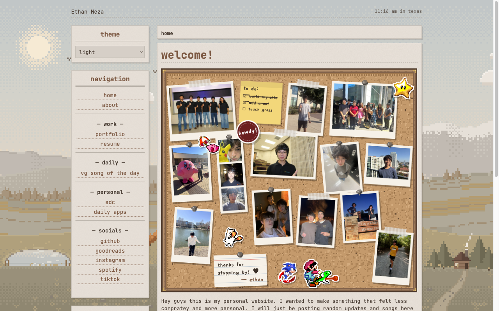
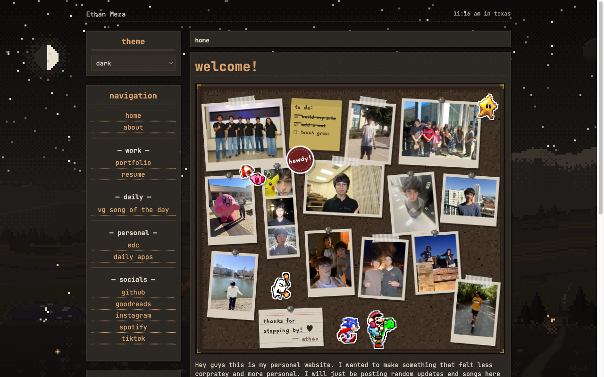
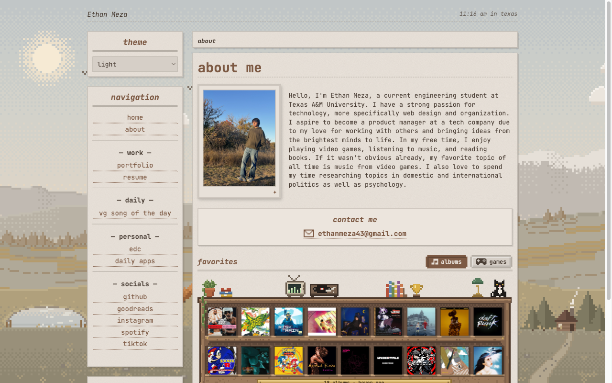
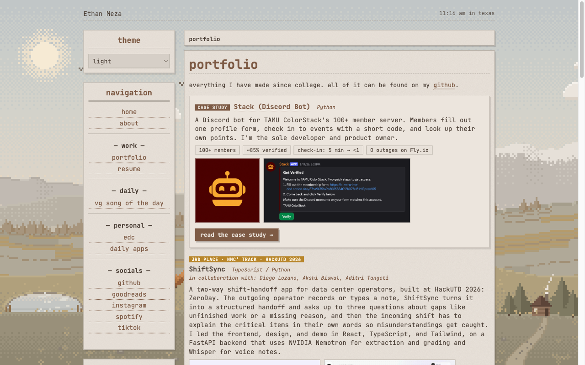
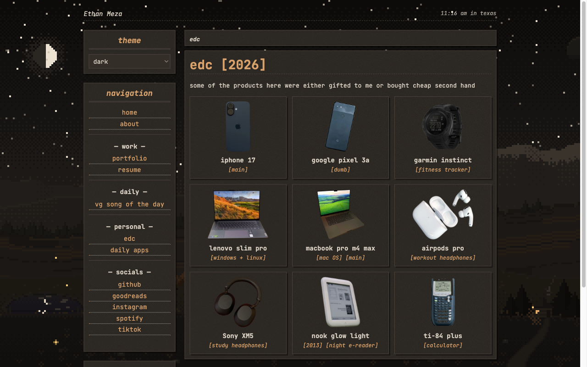
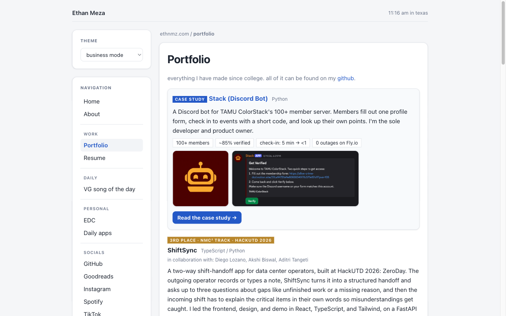

# ethnmz.com

My personal website: a cozy corner of the internet with a photo board, my portfolio, a video game song of the day, and the stuff I use every day. The background is pixel art drawn live in the browser. It turns to night in dark mode and changes with the seasons and holidays.

**[ethnmz.com](https://ethnmz.com)**



| dark mode | about |
| --- | --- |
|  |  |
| **portfolio** | **edc** |
|  |  |
| **business mode** | |
|  | |

## Built with

- [Eleventy](https://www.11ty.dev/) templates in `src/`, with lists like projects and EDC items in `src/_data/`
- plain HTML, CSS, and JavaScript, no framework
- canvas pixel art in `assets/v2.js`
- GitHub Pages, deployed by GitHub Actions on every push to `main`

## Run it locally

```sh
npm install
npm start
```
